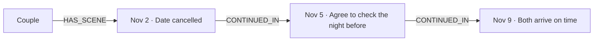

# HowPair × Relate

A retrieval prototype for the [Relate by Neo4j Hackathon](https://relate.devpost.com/). It finds dated evidence across fictional Korean chats about a couple's plans, agreements, and follow-through.

하우페어 상담의 근거 검색 실험입니다. 합성 카톡에서 날짜가 다른 장면을 연결하고, 같은 질문으로 키워드·의미·Relate 검색 결과를 비교합니다.

## Run it

Use Node.js 22 or newer on a platform supported by [Relate's native Node.js package](https://relatedb.ai/docs/guides/embed/node/). The first search downloads approximately 145 MB of public model files from Hugging Face. Embedding runs locally, and all examples use fictional data. No account or API key is needed.

```sh
npm ci
npm run demo
npm run inspect
npm run benchmark
npm test
```

`demo` shows what each search returned and prints dated quotes for the Relate results. `inspect` loads the [persistent Relate store](data/demo.rl) read-only and lists its 16 connections. `benchmark` evaluates 22 questions over 42 scenes, with at most four returned scenes per method.

Use `--couple`, `--question`, `--from`, and `--through` to try a different question. Dates are inclusive.

```sh
npm run demo -- --couple evening --from 2026-11-05 --through 2026-11-15 \
  --question '밤에 통화 소리 때문에 잠을 못 잔 뒤에, 실제로 어떻게 됐어?'
node src/cli.mjs benchmark --json
```

Rebuild the graph from the public fixtures and inspect that file independently.

```sh
npm run seed -- --store .local/rebuilt.rl
npm run inspect -- --store .local/rebuilt.rl
```

## What Relate adds

The default question asks whether the couple followed the plan they made after a cancelled date. The first message describes the cancellation. The agreement and the evidence that they followed it occur on different days and use different words.



The same [multilingual E5 model](https://huggingface.co/intfloat/multilingual-e5-small) ranks individual passages for both semantic methods. When a question uses follow-up language, Relate starts at the highest-ranked passage and queries up to two `CONTINUED_IN` edges in either direction. Every scene along the path must belong to the requested couple and date range. The demo shows which edges added evidence and displays the original dated quotes. The [Cypher query](src/graph.mjs) runs against the embedded database.

## First benchmark

| Question group | Keyword | Semantic | Semantic + Relate |
| --- | ---: | ---: | ---: |
| Found all required evidence across dates | 0/10 | 5/10 | 10/10 |
| Found all required evidence on single-scene lookups | 5/5 | 5/5 | 5/5 |
| Found all required evidence on harder paraphrases, distractors, and multiple threads | 2/4 | 2/4 | 3/4 |
| Returned no scenes when evidence was absent | 2/3 | 1/3 | 1/3 |

Reproduced on macOS with Node.js 24. The keyword search is a standalone approximation using case-insensitive token matching. The two semantic methods share passage vectors, the corpus, date filters, and the four-scene limit. The benchmark measures retrieval. The demo shows quotes and paths with no generated counseling advice.

The scenes and graph links were authored for the prototype, and [the expected evidence for each question](data/questions.mjs) is only used in scoring. This measures retrieval when relevant links are already available. On the cross-thread question about cancelled plans and slow replies, Relate found one of the two required agreements. On two questions with no evidence in the requested couple's archive, both semantic methods returned unrelated candidates. Evaluating automatic link extraction and reliable abstention is necessary before using this with live conversations.

## Submission provenance

Created for the hackathon on November 24, 2026. The use case comes from HowPair's existing counseling feature. This repository contains newly written code and synthetic dialogue. It uses Relate 1.2.0, its native Node.js bindings and single-file store, Cypher, Transformers.js, and a pinned quantized ONNX build of multilingual E5. Codex helped author the prototype, synthetic examples, and documentation.

## Try the chatbot

The chatbot uses a local language model to write Korean answers. Open each answer's sources to see the original line and its date. You can switch between semantic search, automatic Relate links, and the manually reviewed graph. Follow-up questions use the preceding question in the same chat. Changing the sample couple clears that chat's history.

Install [llama.cpp](https://github.com/ggml-org/llama.cpp/releases) and download the pinned [Qwen3 4B Instruct quantization](https://huggingface.co/bartowski/Qwen_Qwen3-4B-Instruct-2507-GGUF) (about 2.5 GB). Run the model and the web app in separate terminals from the repository directory.

```sh
mkdir -p .local/llm
curl --fail --location \
  'https://huggingface.co/bartowski/Qwen_Qwen3-4B-Instruct-2507-GGUF/resolve/ae44f08e1392f39c0e474af10c3ff8355c8b6688/Qwen_Qwen3-4B-Instruct-2507-Q4_K_M.gguf' \
  --output .local/llm/model.gguf
llama-server -m .local/llm/model.gguf --host 127.0.0.1 --port 18128 \
  --ctx-size 8192 --parallel 1 --no-webui --log-disable
```

```sh
npm ci
npm run chat
```

Open [the local chat](http://127.0.0.1:18129/). Both the app and model listen on the loopback interface. The public chatbot contains fictional data only. It does not connect to the HowPair production database.

### Compare generated answers

```sh
node src/chat-cli.mjs benchmark --case plans,trip,noise,explicit-day,foreign-couple,missing-topic,outside-archive,cross-episode
```

The command emits one JSON record per question and search method. It includes elapsed time, retrieved scene IDs, original cited lines, and predicted graph links. The `allRequiredSources` field checks whether the reply cites every scene labeled relevant in the retrieval benchmark. Some questions can be answered accurately using a subset. Read the text and citations to assess answer accuracy.

The automatic mode asks the local model to identify links among the 12 best semantic candidates for a follow-up question. It checks the line IDs, chronology, and connection to the top-ranked scene before using Relate to traverse the proposed links. A valid line ID establishes that the text exists. Same-event continuity and the answer's interpretation must be assessed separately.

In an eight-question synthetic run, each mode abstained on all three questions with no evidence. Two models were checked independently: local Qwen3-4B-Instruct and the GPT-6 Luna model HowPair uses for counseling by default. Luna with the reviewed graph answered whether the couple followed the scheduling plan. With semantic search or automatic links it abstained on that question. All three Luna modes missed the reply-time agreement when the question asked about two separate incidents. Local Qwen sometimes described a later intention instead of the action that actually happened, and supplied an unsupported explanation in the noise case despite valid citations. The answer experiment shows that the retrieved context can help and that exact citations do not guarantee a correct answer.
